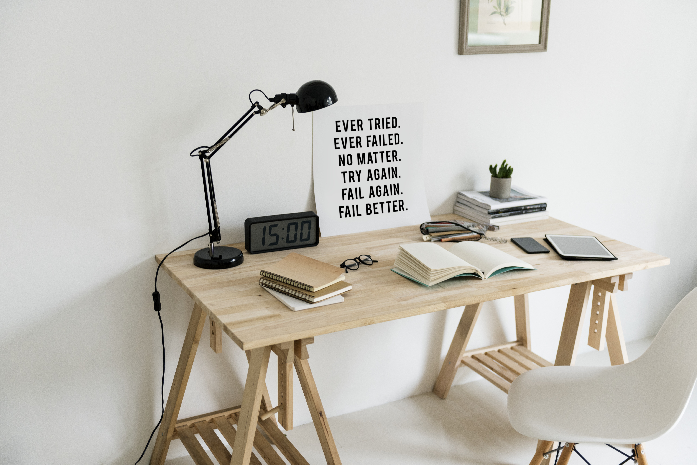

# 👋 Hi, I'm Mobarok Hossen

### 🚀 Aspiring MERN Stack Web Developer

📍 Sirajganj, Bangladesh

---

## 🧑‍💻 About Me

I am an aspiring **MERN stack web developer** who is constantly learning and practicing new languages, frameworks, libraries and tools. I always focus on **problem solving** and keep preparing myself for bigger challenges. I also make smart use of **AI agents and tools** to learn faster and gain a deeper understanding of coding and project management.

  

---

## 🛠️ Technical Skills

  
  
  
  
  
  
  

  
  
  
  
  

---

## 🤝 Soft Skills

---

## 📊 GitHub Stats

  
  

---

## 📬 Let's Connect

  
  
  
  
  

  📱 WhatsApp: <b>01610102698</b> &nbsp;|&nbsp; ✉️ <b>mhossen0102@gmail.com</b>

### ⭐ Thanks for visiting my profile! Let's build something great together. ⭐

